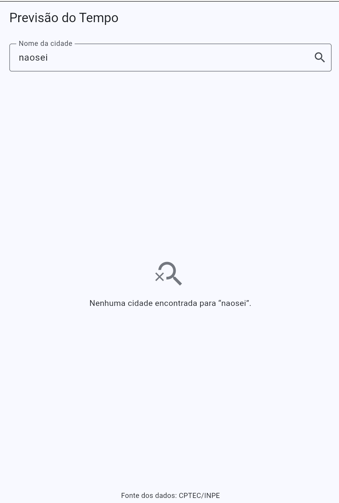

# Previsão do Tempo

Aplicativo Flutter para consultar a previsão do tempo de cidades brasileiras com dados do **CPTEC/INPE**.
Atividade 2 — Programação para Dispositivos Móveis II (Prof. Arley).

## Funcionalidades

- **Pesquisa de cidades** pelo nome (consulta `listaCidades` do CPTEC/INPE). O resultado mostra cidade e UF; o ID usado na previsão é o retornado pelo serviço.
- **Previsão de 4 dias** com, para cada dia: data, temperatura mínima e máxima (°C), descrição da condição, ícone oficial do CPTEC e índice UV (quando disponível), além da data de atualização informada pelo serviço.
- **Gráfico de temperaturas** (máxima e mínima) dos dias retornados.
- **Siglas convertidas em descrições** (`pn` → "Parcialmente nublado", etc.), conforme a documentação do CPTEC.
- **Atualização**: botão na barra superior e *pull-to-refresh*.
- **Estados e erros**: indicador de carregamento; "nenhuma cidade encontrada"; falha de conexão, tempo esgotado, serviço indisponível e XML inválido com mensagem e botão de tentar de novo; mensagem quando não há previsão; campos ausentes são tolerados (aparecem como "—" ou "Condição não informada").
- **Fonte dos dados** identificada na tela: CPTEC/INPE.
- **Funciona offline** com a última previsão salva (aviso "Exibindo dados salvos").

## Como executar

Pré-requisitos: [Flutter SDK](https://docs.flutter.dev/get-started/install) (Dart 3.5+) e um emulador ou dispositivo.

```bash
# 1. Entre na pasta do projeto
cd previsao_tempo

# 2. Gere as pastas de plataforma (android/, ios/, ...) que não estão no repositório
flutter create . --project-name previsao_tempo

# 3. Instale as dependências
flutter pub get

# 4. Execute
flutter run
```

Testes: `flutter test`

> **Android:** em `android/app/src/main/AndroidManifest.xml`, antes de `<application>`, inclua
> `<uses-permission android:name="android.permission.INTERNET"/>` (necessário em *release*).
> O app tenta HTTPS primeiro e, se falhar, HTTP. Para o HTTP funcionar, adicione
> `android:usesCleartextTraffic="true"` na tag `<application>`.
> No iOS, o mesmo fallback exige uma exceção `NSAppTransportSecurity` para `servicos.cptec.inpe.br` no `Info.plist`.

## Serviço utilizado

Web service XML do CPTEC/INPE (<http://servicos.cptec.inpe.br/XML/>):

- Localidades: `GET /XML/listaCidades?city={nome sem acentos}` → `<cidade><nome/><uf/><id/></cidade>`
- Previsão de 4 dias: `GET /XML/cidade/{id}/previsao.xml` → `<nome/> <uf/> <atualizacao/>` e vários `<previsao><dia/><tempo/><maxima/><minima/><iuv/></previsao>`
- Ícones: `s1.cptec.inpe.br/webcptec/common/assets/images/icones/tempo/icones-grandes/{sigla}.png`

## Bibliotecas

| Pacote | Uso |
| --- | --- |
| `http` | Requisições HTTP |
| `xml` | Interpretação das respostas XML |
| `shared_preferences` | Persistência local |
| `fl_chart` | Gráfico de temperaturas |
| `intl` / `flutter_localizations` | Datas e textos em pt-BR |

## Persistência local

Usa `shared_preferences`, guardando JSON em duas chaves:

- `recent_cities`: até 8 cidades pesquisadas por último (exibidas na tela inicial, podem ser removidas).
- `forecast_cache`: última previsão obtida com sucesso por cidade (ID → previsão). É gravada a cada consulta bem-sucedida e só é exibida quando uma nova consulta falha.

## Estrutura

```
lib/
├── main.dart
├── models/      models.dart (City, DayForecast, Forecast), conditions.dart (siglas, ícones, UV)
├── services/    weather_service.dart (HTTP + parser XML), storage_service.dart
├── screens/     search_screen, forecast_screen, temperature_chart
└── utils/       format.dart
test/            parser_test.dart
```

## Capturas de tela

Adicione as imagens em `docs/screenshots/` e ajuste os nomes abaixo.

| Pesquisa | Previsão | Gráfico | Erro / dados salvos |
| --- | --- | --- | --- |
|  |  |  |
